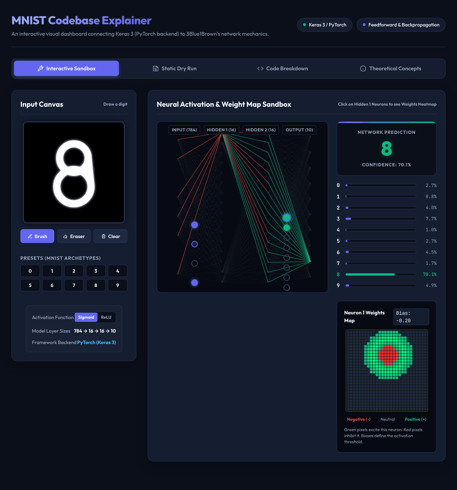
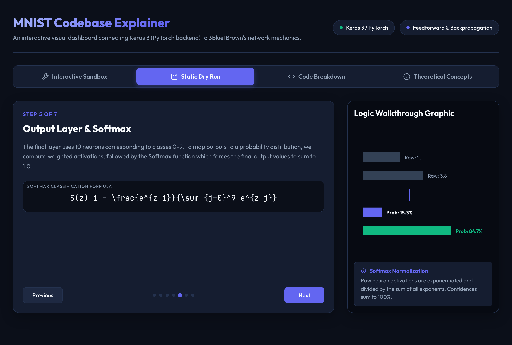
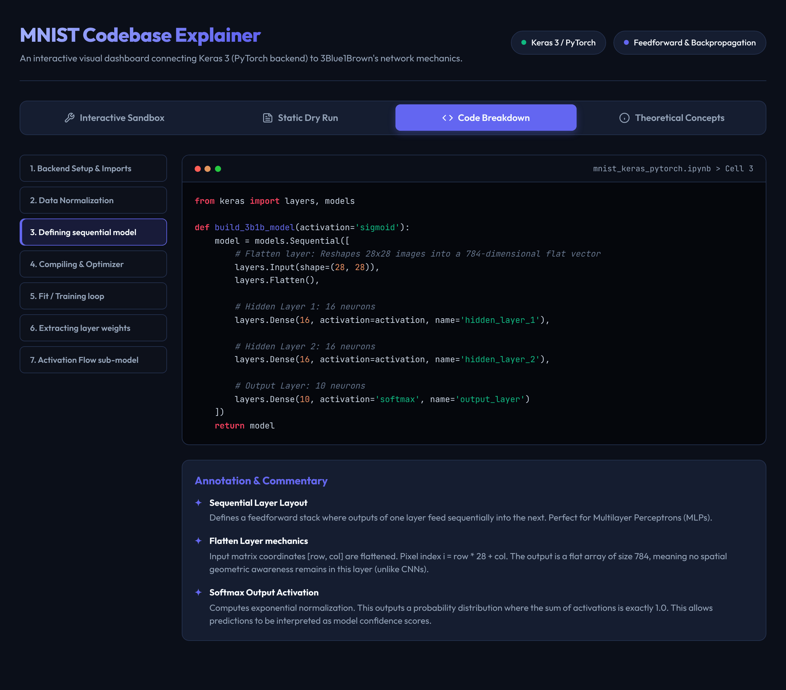

# MNIST Digit Classifier: Keras 3 on a PyTorch backend

> Train a tiny neural network to read handwritten digits, then open it up and look at what it learned. Built with Keras 3 running on PyTorch, and explained alongside [3Blue1Brown's neural network series](https://www.3blue1brown.com/topics/neural-networks).

[](https://colab.research.google.com/github/kriti1901/mnist-project/blob/main/mnist_keras_pytorch.ipynb)




## What this project is

A small feedforward network (a multilayer perceptron, **784 → 16 → 16 → 10**, 13,002 parameters) trained on [MNIST](https://keras.io/api/datasets/mnist/): 60,000 training and 10,000 test images of handwritten digits. It is the same architecture used in 3Blue1Brown's videos, so each step of the code lines up with an idea from the series.

The project has three parts:

- a **notebook** that builds, trains and visualizes the network,
- an **interactive dashboard** (one HTML file) that explains the ideas visually,
- a **written document** with the technical background.

**What you'll learn**

- Running Keras 3 on the PyTorch backend, and why `KERAS_BACKEND` has to be set *before* `import keras`.
- Loading, normalizing and visualizing MNIST.
- Building, compiling and training a small network, and reading its loss and accuracy curves.
- Looking inside the model: weight heatmaps for hidden neurons and layer-by-layer activations.
- Comparing Sigmoid and ReLU activations under identical training.

## What's in this repo

| Path | What it is |
|---|---|
| [`mnist_keras_pytorch.ipynb`](mnist_keras_pytorch.ipynb) | The main tutorial notebook: seven sections of explanation and code. Runs on Google Colab or locally. |
| [`mnist_explainer.html`](mnist_explainer.html) | A self-contained interactive dashboard with four tabs. Open it in any browser, no install needed. |
| [`mnist_notebook_documentation.md`](mnist_notebook_documentation.md) | Longer written documentation: technologies, pipeline, uses and future enhancements. |
| [`krititesting.py`](krititesting.py) | A quick environment check: sets the PyTorch backend, prints library versions, loads MNIST and shows one training image. |
| [`requirements.txt`](requirements.txt) | Python dependencies for running everything locally. |
| [`docs/images/`](docs/images) | Screenshots used in this README. |

## Quick start

### Option A: Google Colab (no install, free GPU)

1. Click the **Open in Colab** badge above.
2. *(Optional)* **Runtime → Change runtime type → T4 GPU**.
3. Run the cells from top to bottom.

### Option B: Run it locally

You need Python 3.11 or newer and an internet connection for the first run (MNIST is downloaded once, about 11 MB, and cached in `~/.keras/datasets/`).

```bash
git clone https://github.com/kriti1901/mnist-project.git
cd mnist-project
python -m venv .venv
source .venv/bin/activate      # on Windows: .venv\Scripts\activate
pip install -r requirements.txt
jupyter notebook mnist_keras_pytorch.ipynb
```

Want to check your setup first? This prints the Keras and PyTorch versions, confirms the backend is `torch`, loads MNIST and shows one training image:

```bash
python krititesting.py
```

### Option C: Just explore the dashboard

Open [`mnist_explainer.html`](mnist_explainer.html) in a browser. It has no dependencies; the only thing fetched from the internet is the web fonts, and it falls back to system fonts when offline.

## The notebook, step by step

| # | Section | What happens |
|---|---|---|
| 1 | Visualizing the dataset | Load MNIST, scale pixel values from `[0, 255]` to `[0, 1]`, plot sample digits. |
| 2 | Model architecture | Build the 784 → 16 → 16 → 10 network: Sigmoid hidden layers, Softmax output. |
| 3 | Loss and backpropagation | Compile with `sparse_categorical_crossentropy` and the Adam optimizer. |
| 4 | Training | 15 epochs, batch size 64, 20% of the training data held out for validation; plot the loss and accuracy curves. |
| 5 | Hidden-layer weights | Reshape each first-layer neuron's 784 weights into a 28×28 image and plot it (green = positive, red = negative). |
| 6 | Activation flow | Build a sub-model that exposes every layer's activations and follow single test digits through the network. |
| 7 | Sigmoid vs ReLU | Train the same model with ReLU hidden layers and compare validation and test accuracy. |

## The interactive explainer

[`mnist_explainer.html`](mnist_explainer.html) connects the code to the ideas from 3Blue1Brown's Chapters 1–4. It has four tabs:

| Tab | What it shows |
|---|---|
| **Interactive Sandbox** | Draw a digit (or pick a preset), watch activations move through the 784 → 16 → 16 → 10 network, click a hidden neuron to see its 28×28 weight map, and switch between Sigmoid and ReLU. |
| **Static Dry Run** | A seven-step walkthrough of one forward pass and the backpropagation update, each with its equation and a small diagram. |
| **Code Breakdown** | The notebook's key code blocks, annotated line by line. |
| **Theoretical Concepts** | Short notes on neurons, cost functions, gradient descent and the calculus of backpropagation, mapped to Chapters 1–4. |





> **Note:** the sandbox is a teaching illustration, not the trained model. Its weights are generated by hand in JavaScript, not loaded from the notebook, so its predictions are for intuition only and it often misreads digits. For real predictions, use the notebook (section 6).

## Troubleshooting

- **`Using backend:` doesn't print `torch`.** Keras reads `KERAS_BACKEND` only when it is first imported. Restart the kernel (or the Colab runtime) and run the first code cell before anything else imports Keras.
- **A very large download when installing PyTorch on Linux.** The default build bundles CUDA libraries. For a smaller CPU-only install, pick the CPU option in the selector at [pytorch.org](https://pytorch.org/get-started/locally/) and install that before the rest of `requirements.txt`.
- **`python krititesting.py` pauses after printing the versions.** It calls `plt.show()`, which keeps the script open until you close the image window.
- **Results change from run to run.** The notebook doesn't set a random seed. Add `keras.utils.set_random_seed(42)` near the top for more repeatable runs.

## Where to go next

The notebook's closing section suggests two experiments: try 128 or 256 neurons per hidden layer, or swap the dense layers for convolutional ones (`layers.Conv2D`) to push accuracy above 99%. [`mnist_notebook_documentation.md`](mnist_notebook_documentation.md) lists further ideas: custom callbacks that track gradient norms, a learning-rate schedule such as cosine decay, and post-training quantization for edge deployment.

## Acknowledgements

- [3Blue1Brown](https://www.3blue1brown.com/topics/neural-networks) for the neural network series this project follows. This is an independent educational project and is not affiliated with or endorsed by 3Blue1Brown.
- [Keras 3](https://keras.io/keras_3/), the multi-backend framework used here.
- The [MNIST database](https://keras.io/api/datasets/mnist/) of handwritten digits, by Yann LeCun, Corinna Cortes and Christopher J.C. Burges.
